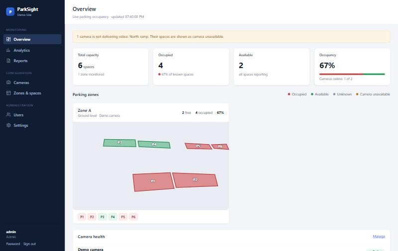
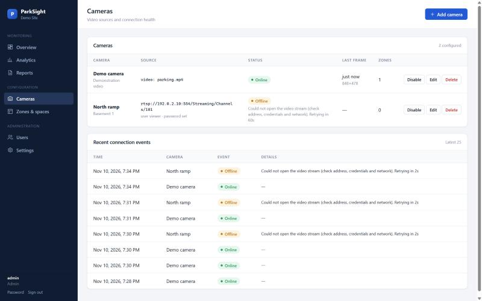
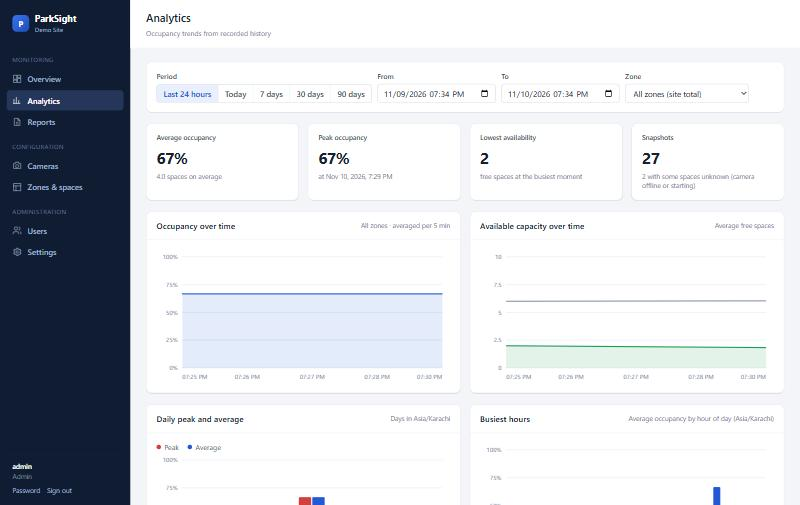

# ParkSight

**On-premise parking occupancy monitoring from your existing CCTV cameras.**

ParkSight watches parking areas through standard IP cameras, works out which bays are free, and gives facility teams a live dashboard, camera health monitoring, historical analytics and CSV reports — running entirely on a computer at the customer's site. No cloud hosting, no paid AI APIs, no subscriptions, and no video is stored.



## Who it is for

Shopping malls, hospitals, universities, office complexes, hotels and managed car parks that already have CCTV and want to know — without walking the floors — how full each area is, where free spaces are, when peaks happen, and whether every camera is actually working.

## Features

| | |
|---|---|
| **Live occupancy** | Site, zone and per-space state (occupied / available / unknown / camera unavailable), updated every few seconds |
| **Multiple cameras, zones and floors** | Each zone belongs to one camera; zones carry a floor/area label |
| **Camera management** | Add, edit, enable/disable and delete RTSP cameras or demo video files from the browser; *Test connection*; automatic reconnection with back-off; connection event log |
| **Honest camera health** | A camera that stops delivering video is shown as offline/stale and its spaces become *camera unavailable* — never stale numbers |
| **Browser calibration** | Draw each bay (4 clicks) on a live snapshot, drag corners, rename, delete. Installer debug view shows detections and ground-contact points |
| **Analytics** | Occupancy and free capacity over time, daily peak/average, busiest hours, zone comparison, date-range and zone filters |
| **Reports** | CSV export (Excel-friendly, site time zone + UTC) and paginated record browser |
| **Access control** | Administrator and viewer roles, local accounts, secure sessions |
| **Privacy by design** | No recording, no face or plate recognition, configurable retention, history deletion |

| Cameras | Analytics |
|---|---|
|  |  |

## How occupancy is determined

1. Every processing interval (default 1 s) the latest frame of each camera is analysed by a YOLO vehicle detector (cars, motorcycles, buses, trucks).
2. Each vehicle contributes five **ground-contact points** along the bottom of its bounding box, where the tyres meet the ground. A bay is *detected* occupied when one of those points lies inside its polygon. Using the tyre line (not the box centre or box overlap) is what makes oblique CCTV views work: the top of a car's box usually covers the bay behind it. A vehicle straddling two bays marks both.
3. **Temporal smoothing**: a bay is occupied when at least 5 of its last 8 observations (configurable) saw a vehicle, which removes single-frame misses and cars driving past.
4. A bay is **unknown** until enough observations exist (start-up, after an outage), and **camera unavailable** while its camera is not delivering video.

> **Accuracy depends on the installation.** Camera position and angle, image resolution and compression, lighting (night, glare, rain), occlusion by pillars or other vehicles, and how carefully bays are drawn all affect results. Validate each camera on site before relying on the numbers. ParkSight reports what the camera can see; it does not guarantee correctness.

## Architecture

```text
 CCTV / IP cameras (RTSP)      demo video files
            │                         │
            └──────────┬──────────────┘
                       ▼
  ┌─────────────────────────── ParkSight (one process) ───────────────────────────┐
  │  Camera workers (per camera)                                                  │
  │   reader thread ── open/timeouts/reconnect, keeps latest frame in memory       │
  │   processor ────── vehicle detection (shared YOLO, CPU) → occupancy engine     │
  │                       ▼                                                       │
  │  Monitoring service ── per space / zone / camera / site status                │
  │                       │ snapshot every N s        ▲                           │
  │                       ▼                           │                           │
  │  FastAPI ── REST API (/api/…) + dashboard (static HTML/JS) + auth             │
  └───────────────────────┬───────────────────────────────────────────────────────┘
                          ▼
                    PostgreSQL ── cameras, zones, spaces, users, sessions,
                                  settings, camera events, occupancy history
```

A single monolithic service by design: no message queues or extra infrastructure. One disconnected camera only affects its own worker.

| Layer | Technology |
|---|---|
| Detection | Ultralytics YOLO11n (COCO-pretrained), PyTorch CPU |
| Video | OpenCV / FFmpeg |
| Backend | Python (tested on 3.10; Docker image uses 3.12, not yet built), FastAPI, Uvicorn, Pydantic |
| Database | PostgreSQL 14+ (tested natively on 18; Compose uses 17, not yet run), psycopg2 |
| Frontend | Plain HTML/CSS/JavaScript modules — no framework, no CDN, works offline |
| Deployment | Docker Compose, or native Python service |

Code map: `src/camera.py` (capture), `src/detector.py` (YOLO), `src/occupancy.py` (algorithm), `src/monitor.py` (supervision, snapshots, retention), `src/api.py` (HTTP), `src/database.py` + `src/migrations/` (schema), `src/repositories.py`, `src/auth.py`, `src/security.py`, `web/` (UI).

## Hardware requirements

Measured on the development laptop (Intel 11th-gen mobile CPU, 8 logical CPUs, 7.8 GiB RAM, Windows 11, CPU only, YOLO11n at 640 px, 1 PyTorch thread, demo video 848×478) with `python -m scripts.benchmark`:

| Cameras (1 frame/s each) | Inference per frame (median) | Process CPU | Memory |
|---|---|---|---|
| 1 | 44 ms | 22 % of one core | ~380 MiB |
| 4 | 36 ms | 81 % of one core (10 % of machine) | ~560 MiB |

Not yet measured: real 1080p/4K RTSP streams (decoding cost grows with resolution and frame rate), more than 4 cameras, small-form-factor PCs. Run the benchmark on the target hardware during the pilot.

Suggested starting point for a pilot of up to ~8 cameras: a 4-core x86-64 CPU, 8 GB RAM, 50 GB SSD, wired gigabit network to the camera VLAN. No GPU required.

## Installation

### Option A — Docker Compose (recommended for customer sites)

Requires Docker Engine with the Compose plugin (Linux) or Docker Desktop (Windows/macOS). Internet access is only needed once, to build the image.

```bash
git clone <your ParkSight repository> parksight && cd parksight
cp .env.example .env
# Edit .env: set DB_PASSWORD and PARKSIGHT_SECRET_KEY (instructions inside), PARKSIGHT_TIMEZONE
mkdir -p models && cp /path/to/yolo11n.pt models/
docker compose up -d --build
docker compose logs parksight | grep "SETUP TOKEN"
```

Open `http://<server-address>:8000`, enter the setup token and create the first administrator. Demo videos go in `data/videos/`.

- Data persists in Docker volumes `pgdata` (database) and `appdata` (`secret.key` if no key is set in `.env`).
- Both containers restart automatically (`unless-stopped`) and have health checks.
- PostgreSQL is not exposed on the network.
- **Docker deployment status:** the Dockerfile and Compose file are written and the Compose file validates, but the image build and container run have **not yet been executed** in this development environment (Docker Desktop was not running). Build and test it once before the first site visit.

### Option B — Native (development or Windows site PC)

Requires Python 3.10+ (verified on 3.10.11) and PostgreSQL 14+ (verified on 18.6).

```bash
python -m venv .venv
.venv\Scripts\activate            # Windows   (Linux/macOS: source .venv/bin/activate)
pip install -r requirements.txt   # requirements-dev.txt adds the test tools
copy .env.example .env            # then edit DB_* and PARKSIGHT_SECRET_KEY
createdb parksight                # or create it with pgAdmin
uvicorn src.api:app --host 0.0.0.0 --port 8000
```

Run exactly **one** Uvicorn worker: camera processing lives inside the application process. The database schema is created and migrated automatically at start-up. To run as a Windows service, wrap the `uvicorn` command with a service manager such as NSSM or Task Scheduler ("run whether user is logged on or not").

Upgrading an installation of the original single-camera ParkSight: start the new version against the same database. Migration `002_product_schema` keeps all existing `occupancy_history` rows (converted to time-zone-aware timestamps). `python -m src.manage import-legacy` turns the old `data/parking_spaces.json` + `parking.mp4` into a demo camera and zone.

## First-time setup at a site

1. **Cameras** → *Add camera*. Paste the camera's RTSP URL (e.g. Hikvision `rtsp://IP:554/Streaming/Channels/101`, Dahua `rtsp://IP:554/cam/realmonitor?channel=1&subtype=0`). Enter username/password separately or inside the URL — either way they are stored encrypted and never displayed again. Click *Test connection*. Prefer TCP transport. A substream (720p) is usually sufficient and cheaper to decode.
2. **Zones & spaces** → *Add zone* (name, floor/area, camera).
3. *Edit spaces*: click the four ground-level corners of each bay; adjust corners by dragging; rename bays to match the painted numbers; *Save layout*. Tick *Show detections* to see what the detector sees: yellow boxes are vehicles, magenta dots are their ground-contact points; an asterisk after a bay label means "detected in this frame".
4. Watch **Overview** for a few minutes and compare with reality. Adjust confidence and smoothing in **Settings** if needed.
5. **Users** → create viewer accounts for operators.

Spaces are tied to their camera's perspective: moving a zone to another camera deletes its polygons. If a camera's resolution changes later, ParkSight rescales the polygons automatically and the editor asks you to check them.

## Configuration

Deployment settings live in `.env` (see `.env.example`): database, `PARKSIGHT_SECRET_KEY`, time zone, port, model path, CPU threads, image size, cookie security.

Operational settings are edited by administrators in **Settings** and stored in the database:

| Setting | Default | Purpose |
|---|---|---|
| Confidence threshold | 0.50 | Minimum detector confidence |
| Vehicle types | car, motorcycle, bus, truck | Classes counted as vehicles |
| Processing interval | 1.0 s | How often each camera is analysed |
| Observation window / votes | 8 / 5 | Temporal smoothing |
| Stale after | 15 s | No new frame for this long → camera stale, spaces unavailable |
| Reconnect delay | 2 s doubling to 60 s | Back-off for failed cameras |
| Snapshot interval | 60 s | History granularity (≈1,440 rows per zone per day) |
| Retention | 365 days | Older history and camera events are deleted automatically |
| Time zone | from `PARKSIGHT_TIMEZONE` | Daily/hourly analytics and CSV |

## API

Interactive documentation: `http://<server>:8000/api/docs`. All endpoints except `/api/health` and the sign-in endpoints require a session; state-changing requests must send `X-Requested-With: ParkSight`.

| Method & path | Role | Purpose |
|---|---|---|
| `GET /api/health` | public | Liveness + database check (for monitoring) |
| `POST /api/auth/setup` · `login` · `logout` · `password`, `GET /api/auth/me` | — | Authentication |
| `GET /api/status` | viewer | Live site/zone/space/camera status |
| `GET /status`, `GET /history?limit=` | viewer | Original endpoints, same response shape as before (plus `unknown`) |
| `GET /api/history?start&end&zone_id&limit&offset` | viewer | Paginated history (max 1000 per page, max 400-day range) |
| `GET /api/analytics?start&end&zone_id` | viewer | Summary, time series, daily, hourly, zone comparison |
| `GET /api/reports/occupancy.csv?start&end&zone_id` | viewer | CSV export (streamed) |
| `GET /api/cameras`, `GET /api/cameras/events`, `GET /api/zones` | viewer | Configuration and health (no credentials) |
| `POST/PUT/PATCH/DELETE /api/cameras…`, `POST /api/cameras/test`, `GET /api/cameras/{id}/snapshot` | admin | Camera management, live frame for calibration |
| `POST/PUT/DELETE /api/zones…`, `PUT /api/zones/{id}/layout` | admin | Zones and parking-space polygons |
| `GET/POST/PATCH/DELETE /api/users…` | admin | Users |
| `GET/PUT /api/settings`, `GET /api/system`, `POST /api/history/delete` | admin (GET settings: viewer) | Settings, system info, history deletion |

Command line (`python -m src.manage …`, or `docker compose exec parksight python -m src.manage …`): `migrate`, `create-user`, `reset-password` (e.g. a forgotten admin password), `import-legacy`, `purge`.

## Database

PostgreSQL tables: `cameras`, `zones`, `parking_spaces`, `camera_events`, `users`, `sessions`, `app_settings`, `occupancy_history`, `schema_migrations`. Versioned SQL migrations in `src/migrations/` run automatically, under an advisory lock, each in a transaction.

`occupancy_history` holds one row per zone per snapshot (`recorded_at`, camera/zone id and name, capacity, occupied, available, unknown) with a check constraint (`occupied + available + unknown = capacity`) and a unique index on (zone, time) that prevents duplicate snapshots. Site totals are sums over zones at the same `recorded_at`. Zone and camera names are copied so history stays readable after a zone is deleted.

**Backup and restore** (Docker): `./scripts/backup.sh` writes `backups/parksight-<timestamp>.dump`; `./scripts/restore.sh <file>` restores it (asks for confirmation). Natively: `pg_dump -Fc -d parksight -f parksight.dump` and `pg_restore --clean --if-exists -d parksight parksight.dump`. Always keep `.env` (or `data/secret.key`) with the backup — without the secret key, stored camera passwords must be re-entered. Schedule the backup (cron / Task Scheduler) and copy it off the server.

## Security

- Passwords hashed with scrypt; minimum 10 characters; failed sign-ins throttled (5 per 15 min per address and per user).
- Server-side sessions; HttpOnly, SameSite=Strict cookie (set `PARKSIGHT_COOKIE_SECURE=true` behind HTTPS); deactivating a user or changing a password ends their sessions.
- First administrator requires a one-time token printed in the server log, so nobody else on the LAN can claim a fresh install.
- Camera passwords encrypted at rest (Fernet), never returned by the API, and stripped from all log messages and error texts.
- Admin-only routes enforced server-side; all SQL parameterised; strict input validation; Content-Security-Policy and other security headers; CSV formula-injection protection.
- ParkSight serves plain HTTP. For access beyond a trusted LAN, put it behind a TLS reverse proxy (e.g. Caddy or nginx) — not included.

## Privacy

ParkSight is a parking occupancy tool, not a surveillance system.

- Video is processed in memory on the local server and discarded; **no footage or images are stored**. The latest frame is held in memory only, visible to administrators in the calibration editor.
- No facial recognition, no person or identity recognition, no number-plate recognition, no vehicle tracking IDs.
- Only counts per zone are stored, kept for the configured retention period; administrators can delete history before any date.
- Inference runs locally; no data leaves the site. Ultralytics' online checks are disabled (`YOLO_OFFLINE=1`).

## Troubleshooting

| Symptom | Check |
|---|---|
| Camera *Offline* | *Test connection* message; ping the camera from the server; RTSP path for the camera model; username/password; try UDP vs TCP; camera's max RTSP sessions |
| Camera *No video* (stale) | Stream connected but frozen — check camera/NVR load and network; ParkSight reconnects automatically |
| All spaces *Unknown* | Normal for a few seconds after start or reconnect (smoothing warm-up). If persistent: banner "Vehicle detection is not running" → model file missing at `PARKSIGHT_MODEL_PATH` |
| Occupied bays shown free | Use *Show detections*: no yellow box → detector misses (lower confidence, better camera angle/lighting); box but magenta dots outside the bay → redraw the bay at ground level |
| Free bays shown occupied | Neighbouring vehicles' tyre line inside the bay → tighten the polygon; raise votes threshold for passing traffic |
| Setup token lost | Restart the app while no user exists; a new token is printed |
| Forgotten admin password | `python -m src.manage reset-password --username admin` |
| `/api/health` returns 503 | PostgreSQL unreachable — check `DB_*` settings and the database service |
| High CPU | Increase processing interval, use camera substreams, reduce `PARKSIGHT_IMAGE_SIZE` (accuracy trade-off) |

## Testing

```bash
pip install -r requirements-dev.txt
pytest
```

Database tests use a separate `parksight_test` database (created and dropped automatically; needs a PostgreSQL role with CREATEDB) and are skipped if PostgreSQL is unreachable. The end-to-end test drives a synthetic video through capture → detection → occupancy → monitor → PostgreSQL → API → CSV. `tests/test_model.py` runs the real YOLO model on the demo video when the weights and video are present.

## Licensing

**Read [THIRD_PARTY_LICENSES.md](THIRD_PARTY_LICENSES.md) before any commercial deployment.** ParkSight uses Ultralytics YOLO, which together with its model weights is licensed under **AGPL-3.0**. Selling or deploying ParkSight as closed-source software requires either licensing ParkSight itself under AGPL-3.0 (with source available to customers and dashboard users), an Ultralytics Enterprise Licence, or replacing the detector with a permissively licensed model. That decision has not been made yet, and the repository currently has no `LICENSE` file.

## Limitations

- Accuracy has been checked only on one short demo clip; there is no labelled ground-truth evaluation yet. Night, rain, glare and heavy occlusion are untested.
- Docker image build and run not yet executed (see Installation).
- Tested with a local video file and an unreachable RTSP address; **not yet tested against a real IP camera**.
- Bays are judged per camera; a bay visible from two cameras must be configured on only one of them.
- No vehicle counting at entrances/exits, parking duration, or guidance signage integration.
- No built-in HTTPS, e-mail alerts or LDAP/AD sign-in.
- Plain-HTTP polling every 3 s for the live dashboard; suitable for tens of concurrent viewers, not public signage at scale.
- Single process: if the server stops, monitoring stops (Docker/service manager restarts it).
